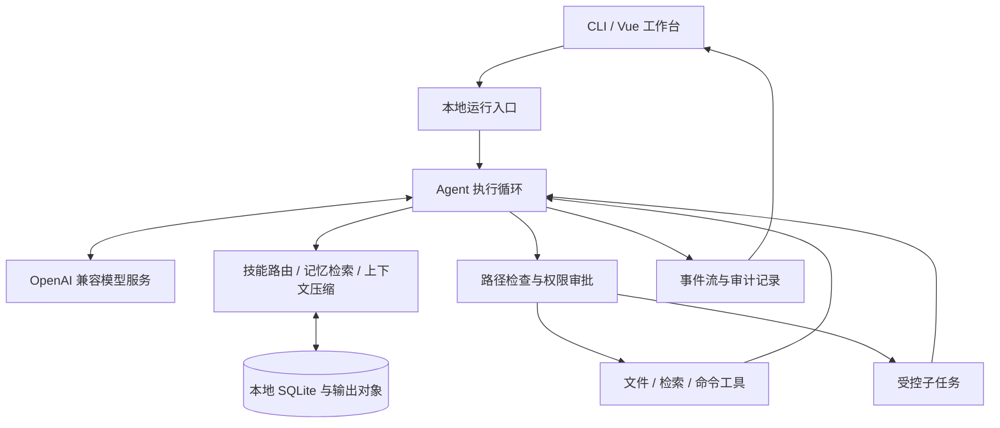

<div align="center">

# nano-code

**面向本地开发工作区的 AI Coding Agent**

从任务理解、工具执行到结果复核，让每一步都有上下文、有边界、可追溯。

[](https://github.com/leonbuilds-ai/nano-code/actions/workflows/ci.yml)


[](LICENSE)

[项目简介](#项目简介) · [核心能力](#核心能力) · [系统架构](#系统架构) · [快速开始](#快速开始) · [使用示例](#使用示例) · [开发验证](#开发验证)

</div>

## 项目简介

nano-code 将对话式模型接入本地工程目录，通过 **Query Loop + Tool Calling** 完成代码阅读、文件检索、受控修改和命令执行。CLI 与 Vue 工作台共享同一个执行内核、会话存储和权限策略。

0.2 采用独立编写的 `nanocode` Python 包和 Vue 前端。项目围绕技能路由、记忆沉淀、上下文治理与受控协作组织能力，强调可运行的工程闭环和可验证的行为边界。

适用于本地代码理解、开发辅助和 Agent 机制研究。默认使用本机模型服务，也支持 OpenAI 兼容接口。

## 核心能力

| 能力 | 实现方式 | 边界 |
| --- | --- | --- |
| 工具执行闭环 | 模型调用、工具调度、结果回传、迭代上限与事件记录 | 模型质量由所接模型决定 |
| 技能分层路由 | 目录、技能与原子工具元数据，两阶段词项召回与加权排序 | 可解释规则检索，不宣称语义模型精排 |
| 本地记忆 | SQLite 持久化、跨会话检索、偏好与执行经验提炼 | 候选技能需审核后激活 |
| 分层上下文 | 大输出外置、内容寻址、按需回读、历史压缩 | 不将结构优化等同于已测量的缓存收益 |
| 受控协作 | 子任务受主 Agent 管理，限制工具、层级与返回内容 | Fork / Team 为只读子任务；Worktree 可经审批修改 |
| 权限审计 | 工作区路径校验、敏感文件限制、修改与命令逐次审批 | 命令使用当前用户权限，不构成系统沙箱 |
| Vue 工作台 | 全屏终端风格、会话管理、流式事件、工具与审批卡片 | 面向本地单用户使用 |

## 系统架构



实现与安全边界见 [设计文档](docs/design.md)。

## 快速开始

本地沿用 `cook-rag-1`，建议 Node.js 22 或更新版本。

```powershell
conda activate cook-rag-1
python -m pip install -e ".[dev]"
npm --prefix frontend ci
npm --prefix frontend run build
```

在当前终端配置模型与工作区。配置不会自动读取 `.env` 文件：

```powershell
$env:NANO_WORKSPACE = (Get-Location).Path
$env:NANO_DATA_DIR = Join-Path $env:NANO_WORKSPACE ".nano-code"
$env:NANO_BASE_URL = "http://localhost:11434/v1"
$env:NANO_API_KEY = "ollama"
$env:NANO_MODEL = "qwen3.5:9b"
python -m nanocode web --port 8865
```

浏览器打开 **http://127.0.0.1:8865**。模型服务应事先启动并提供对应模型。使用远程兼容服务时，只需替换模型地址、密钥和模型名；密钥留在服务端环境变量中。

CLI 示例：

```powershell
python -m nanocode chat "阅读项目配置，解释启动方式"
python -m nanocode chat "继续检查测试入口" --session <会话ID>
```

数据默认保存在工作区的 `.nano-code`。可选设置 `$env:NANO_AI_REVIEW = "1"` 开启辅助风险分类；分类结果不会授予工具执行权限。


## 使用示例


上图由实际运行事件排版展示。验证细节与范围见 [验证记录](docs/verification.md)。

**理解工程**

> 先列出当前工作区的文件，再阅读项目配置和入口，说明模块职责与启动方式。请引用你实际读到的文件。

执行过程：列出目录 → 读取文件 → 返回工具结果 → 生成说明。文件内容按不可信输入处理。

**受控修改**

> 为当前项目添加一个输入校验函数，先说明修改位置，再申请写入。

工作台展示写入参数和内容。用户批准后才执行，拒绝则把拒绝结果返回模型；不会默认授予后续命令权限。

**运行检查**

> 检查刚才的改动，申请运行项目测试，并根据真实输出给出结论。

命令参数进入独立审批。大输出存入本地对象文件，模型可使用引用分段回读。

**跨会话复用**

> 请记住：此项目优先使用中文说明，测试使用 pytest。

用户显式偏好可进入本地记忆。后续任务检索相关记录；成功修复经验可形成待审核技能候选。

技能候选由成功纠错经验生成，在 CLI 中审核后才能进入路由：

```powershell
python -m nanocode skills
python -m nanocode skills --activate <候选ID>
```

Fork 为独立只读子任务，Team 并行执行最多 3 个只读子任务；Worktree 从当前 Git 提交建立隔离分支，工作区未提交的内容不会自动复制，修改与命令继续逐次审批。子任务返回主循环复核，结果不会自动合并。

## 开发验证

```powershell
python -m pytest -q
npm --prefix frontend test
npm --prefix frontend run build
python -m build --no-isolation
```

测试覆盖持久化、上下文协议、工具路径边界、权限状态与 HTTP 事件流。协议测试使用可控响应，真实模型效果应结合所接服务单独验证。GitHub Actions 在 Linux、Windows 执行 Python 检查，并构建 Vue 工作台。

## License & Acknowledgements

本项目采用 [MIT License](LICENSE)。感谢 Python、FastAPI、HTTPX、Vue 和 Vite 等开源生态提供的基础能力；第三方依赖遵循其各自许可证。
