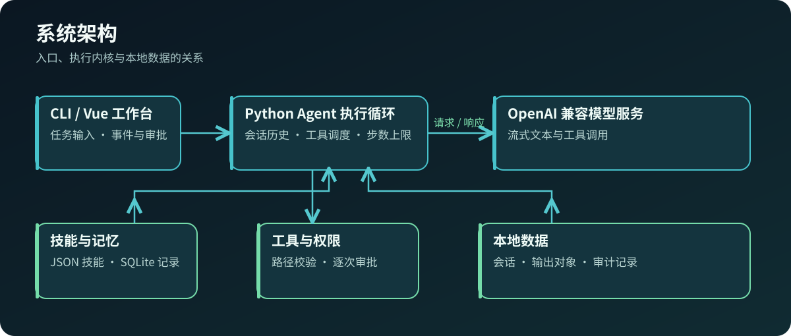
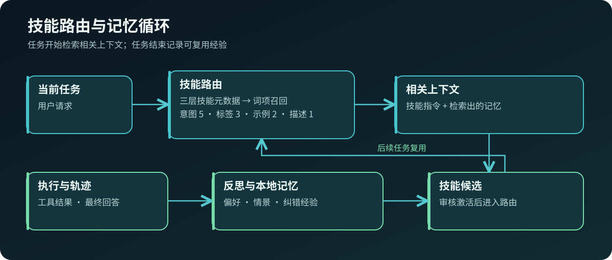
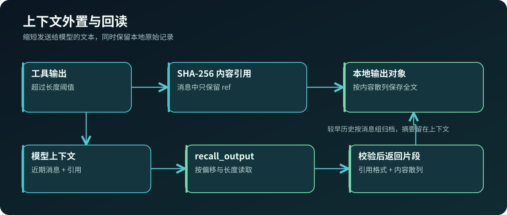
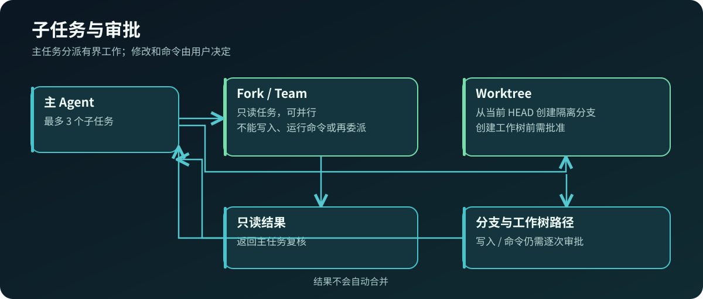

<div align="center">

# nano-code

### 面向本地代码库的 AI 编程助手

基于 Python 与 Vue，集成工具调用、技能路由、长期记忆与多 Agent 协作。

[](https://github.com/leonbuilds-ai/nano-code/actions/workflows/ci.yml)


[](LICENSE)

[项目简介](#项目简介) · [核心能力](#核心能力) · [技术实现](#技术实现) · [快速开始](#快速开始) · [项目结构](#项目结构) · [开发与文档](#开发与文档)

</div>

## 项目简介

nano-code 是一个运行在本机工作区的 AI Coding Agent。它通过 OpenAI 兼容接口连接模型，用工具调用完成代码阅读、文本检索、文件修改和命令执行；CLI 与 Vue 工作台使用同一套 Python 执行内核。你可以从事件流查看正在调用的工具，并对写入、命令和工作树创建逐次作出决定。

工程任务往往需要反复查看文件、修正工具参数、处理过长的输出，并在下一次会话中沿用已知偏好。nano-code 将这些步骤组织为有上限的执行循环：检索相关技能与记忆，调用工具，将结果送回模型，再记录会话与可复用的经验。适合本地代码理解、开发辅助，以及研究 Agent 的工具与上下文机制。



## 核心能力

| 能力 | 具体行为 |
| --- | --- |
| 工具执行 | 模型以流式工具调用读取文件、列目录、搜索文本、写文件或运行命令；每轮设有步数上限，事件可在工作台查看。 |
| 技能路由 | 从目录、工具、技能三层 JSON 元数据中召回候选，按意图、标签、示例和描述的词项命中加权排序，并排除命中的使用边界。 |
| 本地记忆 | SQLite 保存会话、用户偏好与执行观察；任务结束后根据明确偏好及工具轨迹提炼记录。纠错经验可形成待审核技能。 |
| 上下文管理 | 长工具输出按 SHA-256 存储并返回引用，可分段回读；过长历史保留近期消息，并将较早消息组存档与摘要化。 |
| 受控协作 | Fork 和 Team 可分派只读任务，单次主任务最多 3 个子任务；Worktree 经批准后从当前 `HEAD` 创建隔离分支，结果返回主任务，不自动合并。 |
| 权限与审计 | 文件路径限制在工作区内；写入和命令需要逐次审批，执行结果与审批写入本地审计记录。可选 AI 风险分类只提供提示，不授予权限。 |
| 本地工作台 | Vue 页面提供会话、流式文本、工具结果与审批卡片；FastAPI 默认仅监听本机地址。 |

## 技术实现

### 执行循环

用户请求进入会话后，执行内核组合系统指令、相关记忆与技能、压缩后的历史，再向模型发送工具定义。模型返回工具调用时，执行器检查参数与路径，必要时等待审批，执行后把结果送回下一轮。前端接收状态、文本增量、工具结果和审批事件。一次实际模型工具调用记录见 [验证记录](docs/verification.md) 与下图。


### 技能与记忆

内置技能以 JSON 文件描述任务意图、标签、示例、指令和适用边界。路由先用词项寻找候选，再按字段权重排序；每次任务开始会同时检索相关记忆。执行结束后的反思可保存偏好和工具观察；若某工具报错后通过更改参数成功重试，系统可提出技能候选，需通过 `skills` 命令审核并激活。



### 上下文与输出引用

超过长度阈值的工具输出会保存到 SQLite 输出表，消息只保留引用。`recall_output` 可按偏移与长度取回片段；回读时校验引用格式和内容散列。历史超过预算时，较早的完整消息组被归档，当前请求与近期消息仍留在上下文中。该机制控制传给模型的文本规模，原始记录仍可在本地查找。



### 协作与审批

只读子任务可以检索和读取工作区内容，不能写文件、执行命令或继续委派。Worktree 子任务从当前 Git `HEAD` 建立新工作树，创建工作树及后续写入、命令分别经过审批；返回分支与工作树路径供人工检查。命令以当前用户权限运行，审批是执行授权，并非系统沙箱。



技术栈：Python 3.11+、FastAPI、HTTPX、SQLite；前端使用 Vue 3、Vite 与 Node.js 22+。实现细节见 [设计文档](docs/design.md)。

## 快速开始

准备 Python 3.11+、Node.js 22+，以及支持 OpenAI 兼容 `chat/completions` 流式工具调用的模型服务。在仓库根目录执行：

```powershell
python -m venv .venv
.\.venv\Scripts\Activate.ps1
python -m pip install -e ".[dev]"
npm --prefix frontend ci
npm --prefix frontend run build
```

在同一终端指定工作区和模型连接。`NANO_WORKSPACE` 应指向你希望助手处理的代码目录；环境变量需在启动前设置，程序不会自动加载 `.env`。

```powershell
$env:NANO_WORKSPACE = (Get-Location).Path
$env:NANO_BASE_URL = "http://127.0.0.1:11434/v1"
$env:NANO_API_KEY = "your-api-key"
$env:NANO_MODEL = "your-model-name"
python -m nanocode web --port 8865
```

打开 [http://127.0.0.1:8865](http://127.0.0.1:8865) 使用工作台。CLI 也可直接运行：

```powershell
python -m nanocode chat "阅读项目配置，说明启动方式"
python -m nanocode chat "继续检查测试入口" --session <会话ID>
python -m nanocode skills
python -m nanocode skills --activate <候选ID>
```

`NANO_BASE_URL` 是服务根地址，程序会追加 `/chat/completions`；`NANO_API_KEY` 和 `NANO_MODEL` 分别对应服务密钥与模型名称。未设置时使用本地模型服务的默认配置。会话和输出默认存于工作区 `.nano-code`，可用 `NANO_DATA_DIR` 指定其他目录；`NANO_AI_REVIEW=1` 可开启辅助风险分类。

## 项目结构

```text
src/nanocode/           Python 执行内核、工具、权限与知识存储
src/nanocode/resources/ 内置技能元数据
frontend/               Vue 工作台与前端测试
tests/                  Python 行为与接口测试
docs/                   设计、验证记录与技术示意图
```

## 开发与文档

```powershell
python -m pytest -q
npm --prefix frontend test
npm --prefix frontend run build
```

更多实现边界和验证范围见 [设计文档](docs/design.md)、[验证记录](docs/verification.md)。项目采用 [MIT License](LICENSE)。
