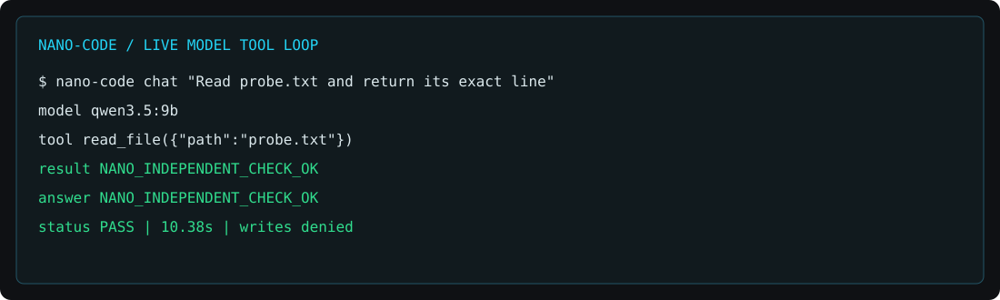

# 验证记录

## 本地真实模型

- 环境：Windows，conda `cook-rag-1`，Python 3.12。
- 模型服务：本地 Ollama，`qwen3.5:9b`，OpenAI 兼容流式接口。
- 操作：在隔离工作区创建 `probe.txt`，由模型调用 `read_file`，检查最终回答与文件内容一致。
- 结果：通过，耗时 10.38 秒。所有修改和命令审批均返回拒绝。
- 范围：验证一次真实工具闭环，不代表复杂编程任务的准确率评测。

图片根据实际事件与断言结果排版，并非网页截图。新版网页已通过构建与 API/状态测试；尚未完成浏览器视觉验收。

## 自动检查

自动检查命令、跨平台结果以分支 CI 为准。测试分别覆盖存储、路由、上下文、工具权限、风险判定、事件流与前端状态。

本次本地回归：Python 行为测试 22 项、前端状态测试 2 项通过；Vue 构建、源码包与 wheel 构建、安装包 API/静态资源/技能检查均通过。
